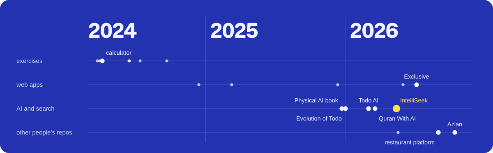

I build web apps and the services behind them. Lately more of my time goes to agents that call tools, and to search: how a pile of documents becomes something you can ask questions of.

The oldest repository here is a command-line calculator from April 2024. The one I'm working on now has a vector index in it.

### What's live

**[IntelliSeek](https://github.com/Mahad-Nawaz-Khan/IntelliSeek)** lets you upload your own documents and search them by meaning instead of by keyword. It splits and embeds the text, searches it with an HNSW index, and completes queries as you type with a trie. Keyword and semantic results are blended into one ranking. There's a [live demo](https://intelliseek-ai.vercel.app).

**[Todo AI](https://github.com/Mahad-Nawaz-Khan/Todo-Ai)** is a task manager you talk to. An agent built on the OpenAI Agents SDK turns plain requests into task changes by calling tools over MCP. Next.js in front, FastAPI and Postgres behind, replies streamed as they're written. [Live demo](https://todoaiapp.vercel.app).

**[Exclusive](https://github.com/Mahad-Nawaz-Khan/E-Commerce-MERN-Project)** is a MERN storefront with an admin side for analytics, inventory and orders. The part worth reading is checkout, where stock is decremented inside a database transaction so the last item can't be sold twice. [Live demo](https://store-exclusive.vercel.app).

**[Evolution of Todo](https://github.com/Mahad-Nawaz-Khan/Hackathon-2-SDD-GIAIC)** is one todo app rebuilt five times: a Python console script, a web app, an AI chatbot over MCP, a Kubernetes deployment, then an event-driven version on Dapr, Kafka and Redis. It was written spec first, and the phase-three auth got a security pass. [Live demo of phase three](https://hackathon-2-phase-3-giaic.vercel.app).

**[Physical AI and Humanoid Robotics](https://github.com/Mahad-Nawaz-Khan/PHYSICAL_AI_BOOK)** is an interactive textbook in English and Urdu, the Urdu set right to left, with a tutor that answers only from the book and shows where each answer came from. [Live demo](https://physical-ai-book-chi.vercel.app).

**[Quran With AI](https://github.com/Mahad-Nawaz-Khan/Quran-With-AI)** is a Quran reader with an assistant for when you want help understanding a passage. [Live demo](https://quran-with-ai.vercel.app).

### In other people's repositories

Most of what I've sent to other people's projects is the last stretch before launch: auth, security, deployment, docs and the interface.

For the ordering app [Asjad Nawaz Khan](https://github.com/Asjadnawaz) built for a restaurant in Karachi, I [fixed privilege escalation, auth bypass and price tampering](https://github.com/Asjadnawaz/Azlan_Dairy_Restaurant/pull/1), then added rate limiting, security headers, installable PWAs for the store and the rider portal, SEO and performance fixes, and the architecture and API docs. My work is on [a fork](https://github.com/Mahad-Nawaz-Khan/Azlan-Dairy-Restaurant).

[sohaibbangash](https://github.com/sohaibbangash)'s [MERN restaurant platform](https://github.com/sohaibbangash/mern-stack-final-project-) got five pull requests from me. The first brought in auth, cart and orders, an admin portal and a UI redesign. Later ones split it into a monorepo (admin, customer, backend), prepared it for production, and made login enforce strict role separation. [My fork](https://github.com/Mahad-Nawaz-Khan/Bano-Qabil-MERN-Project) has the history.

### How it went

Every repository on this account, placed by the date I made it:

2024 was fundamentals: a calculator, a number-guessing game, an ATM, 45 TypeScript assignments from GIAIC, then Next.js, and in December a static résumé page for a hackathon.

In 2025 there was a [random-remarks app](https://github.com/Mahad-Nawaz-Khan/REMARKS-ADDING-APP) in March that its own README calls experimental. Then December: a [humanoid-robotics course site](https://github.com/Mahad-Nawaz-Khan/HUMANOID-ROBOTICS-COURSE), the Physical AI textbook and the first commit of Evolution of Todo, all within about three weeks.

2026 so far: Todo AI and Quran With AI in March, IntelliSeek in May, Exclusive in July. Since May I've also been working in other people's repositories, which is the bottom row.

More at [mahadnawaz.space-z.ai](https://mahadnawaz.space-z.ai).

The big type is Mona Sans, GitHub's own typeface. The first figure is a nearest-neighbour search: enter on the sparse top layer, descend, and stop when no neighbour is closer to the query. The second is the repositories above, placed by date.
